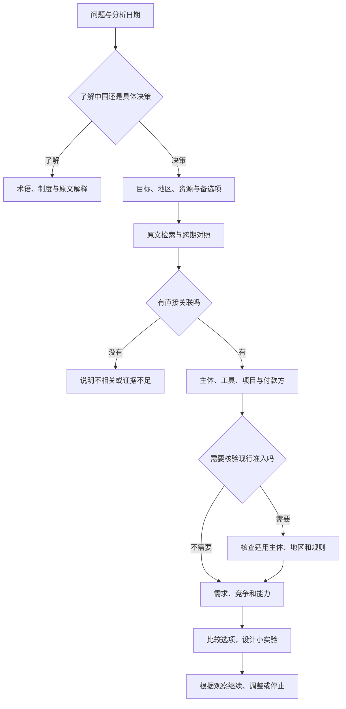

# 从规划到决策：蒸馏后的方法

## 来源与改造

这是对用户提供材料的综合整理，不是官方决策算法。

- 共读营 04 第 5、7–16 页提供“核心表述→跨期对照→方向→政策工具→讨论”的学习路径。
- 十五五纲要第 80–81 页描述专项/区域规划、年度计划、分类落实、财政预算、项目、金融与监测评估的衔接。
- 浙商证券《如何理解“统一大市场”？》第 1 页提示制度、竞争与交易成本机制；《财政投资于人、投资于物如何结合？》第 1 页提醒人力资本积累需要时间。
- 天风证券《“十五五”投资机遇》第 1 页提醒产业方向、业绩验证和整个五年周期的资产收益并不等价。
- 本项目调整：去掉自动选股、短期行情和无基准的“超预期”判断；加入用户能力、进入条件、付款方和验证行动。以上调整属于项目推导。

## 六个判断环节

| 环节 | 问题 | 证据不足时 |
| --- | --- | --- |
| 定义决策 | 什么日期、地区、条件下，比较哪些选项？ | 明确假设，只追问影响结论的信息 |
| 识别政策 | 支持什么、限制什么、仍在试点什么？ | 允许不相关或证据不足 |
| 跨期核对 | 延续、强化、具体化、重组还是新增？纲要和建议有没有混用？ | 没查齐不说“首次”“取消” |
| 追踪落地 | 谁负责、什么工具、哪个区域、何时实施、谁出钱？ | 不把五年目标变成确定订单 |
| 映射角色 | 用户能参与研发、设备、服务、运营、渠道还是配套？客户会付钱吗？ | 只给可检验的机会假设 |
| 设计验证 | 最低成本证据是什么？何时复查？什么情况停止？ | 先补证据再加大投入 |

## 海外用户：三个问题分开

1. 中国希望发展什么：规划提供方向、矛盾与政策工具。
2. 中国客户需要什么：需要访谈、采购、竞争和支付证据。
3. 特定主体能否在特定地区以特定方式经营：需要当期准入、许可、试点、产品和数据规则。

不要把中国市场当作同质市场。按任务选择地区、客户、渠道、本地伙伴、语言与售后、进入方式。纯研究问题无需资金和进入模式。

例如跨境提供企业 AI 服务与设立医疗机构，需要核查的问题不同。只输出相关核查项；未核实时写“待核验”，不写“已准入”。

## 国内用户：趋势映射到可做的事

职业选择关注技能、岗位任务、招聘需求、学习成本和收入中断风险。创业关注客户、付款方、获客与交付成本。企业项目关注采购、回款、资质、差异化和退出成本。政策背景不能替代这些证据。

AI 政策相关性可以强，而某个产品可能没有付费需求；银发经济可以长期受重视，而一个社区服务项目可能支付不足。允许两者同时成立。

## 验证与停止

例：两周内访谈 5 家目标企业，核实同一任务的痛点、预算和试用意愿；取得明确试点意向再投入开发。人数与时限只是该案例的设计，不是硬性通用阈值。

找不到付款方、进入条件不能满足、成本不合算或回收周期承担不起时，应降低投入或换切入点。纯理解问题不强加行动计划。
